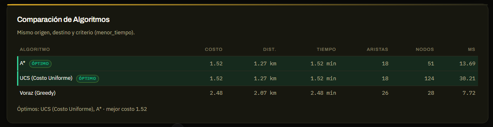

# Informe Corte 2 — Algoritmos de búsqueda y comparación

**Curso:** Inteligencia Artificial (SIST5036) — Universidad Sergio Arboleda, Semestre VI, 2026
**Fecha:** Octubre 2026
**Estado:** Entregado (BFS, DFS, UCS, voraz y A*)
**Repositorio:** <https://github.com/JAGR1792/Proyecto-IA>

---

## 1. Resumen

El Corte 2 pedía **implementar y comparar BFS, DFS, UCS, búsqueda voraz y A\***, incluyendo el análisis de la heurística, la visualización de rutas, pruebas con distintos escenarios, una tabla comparativa, el análisis de admisibilidad y consistencia, y un informe técnico con demostración (`Proyecto_IA.pdf`, pág. 8).

Este informe cubre los **cinco algoritmos del Corte 2** —**BFS, DFS, UCS, voraz y A\***—, la heurística geográfica admisible y consistente, el comparador, el benchmark reproducible, la visualización de rutas y la integración con el agente. BFS y DFS quedaron integrados en el mismo registro central y están disponibles en la API, el comparador, el benchmark y la interfaz.

La red de estudio es la red vial real de Chapinero (OpenStreetMap): **888 nodos y 1.741 aristas**, con tres criterios de optimización del PDF (§5.2): menor tiempo, menor distancia y menor número de conexiones.

---

## 2. Objetivos del corte y cumplimiento

| Entregable del PDF | Estado | Evidencia |
|---|---|---|
| Código funcional con BFS, DFS, UCS, voraz y A* | ✅ Los cinco implementados y registrados en `registro.py` (BFS: ADR-025) | `backend/src/busqueda/` |
| Visualización de rutas | ✅ | `MapaOSM.vue`, `GraphView.vue`, capas conmutables |
| Pruebas con distintos escenarios | ✅ | 209 tests + benchmark con escenario base y cierre del 10 % |
| Tabla comparativa | ✅ | `benchmark_busqueda.py`, endpoint `POST /busqueda/comparar`, tabla en la UI |
| Análisis de admisibilidad y consistencia | ✅ | §5 y `tests/test_heuristicas/test_admisibles.py` |
| Informe técnico | ✅ | Este documento |
| Demostración | ✅ | `documentacion/demo_corte2.md` |

---

## 3. Arquitectura de búsqueda

```
backend/src/busqueda/
├── base.py          # ResultadoBusqueda, costo por criterio, reconstrucción de camino
├── registro.py      # Único lugar donde se declaran los algoritmos disponibles
├── bfs.py           # BFS con cola FIFO y prueba de meta al generar
├── dfs.py           # DFS iterativo con pila LIFO y control de ciclos
├── ucs.py           # Dijkstra / Uniform Cost Search
├── voraz.py         # Greedy best-first con retroceso
├── a_estrella.py    # A* con heurística inyectable
└── comparador.py    # Ejecuta todos y calcula el óptimo

backend/src/heuristicas/admisible.py   # h(n) por criterio, admisible y consistente
backend/benchmark_busqueda.py          # Experimento reproducible (CSV/JSON/Markdown)
```

`registro.crear_algoritmos()` es la fuente única de verdad: la API, el comparador, el benchmark y el agente obtienen de allí los algoritmos. Los cinco motores ya están registrados y aparecen en `/busqueda/algoritmos`, en la tabla comparativa y en el benchmark.

### 3.1 UCS (Uniform Cost Search)

Dijkstra sobre el costo del criterio activo. Mantiene una cola de prioridad `(costo acumulado, nodo)`, cierra cada nodo una sola vez y reconstruye el camino con los predecesores. Es **óptimo** para costos no negativos y sirve de referencia de optimalidad.

- Complejidad: `O((V + E) log V)` con montículo binario.
- Criterios: `costo_arista()` devuelve minutos, metros o 1 por arista.

### 3.2 A*

Expande la frontera con menor `f(n) = g(n) + h(n)`, donde `g` es el costo acumulado y `h` la estimación admisible hasta el destino. Con `h` admisible y consistente devuelve la ruta de costo mínimo y, al dirigir la exploración, expande menos nodos que UCS. La heurística es inyectable: `h ≡ 0` equivale a UCS (usado en los tests para comprobar equivalencia).

- Complejidad: `O((V + E) log V)` en el peor caso; en la práctica mucho menor.
- Se cierra cada nodo una vez; con `h` consistente no hace falta reabrirlo.

### 3.3 Búsqueda voraz (baseline no óptimo)

En cada paso elige el vecino con menor distancia aérea al destino y retrocede si cae en un callejón sin salida. Se conserva como **baseline** para cuantificar cuánto se pierde al no optimizar el costo global.

### 3.4 BFS (amplitud)

Usa una cola FIFO y un conjunto de nodos alcanzados. La prueba de meta se hace al generar cada vecino, por lo que devuelve la ruta con menos aristas y evita expandir el último nivel completo. No usa costos ni heurística: para `menor_tiempo` y `menor_distancia` no es óptimo, pero sirve como línea base no informada. Su detalle incluye `nodos_alcanzados` y `max_frontera`.

### 3.5 DFS (profundidad)

Usa una pila LIFO con retroceso y control de ciclos. Encuentra una ruta transitable, pero no garantiza el menor costo ni el menor número de aristas. Descarta aristas no disponibles y aristas con congestión `BLOQUEADA`. Es el baseline que muestra el costo de explorar sin optimizar.

---

## 4. Modelo de costo y heurística

### 4.1 Criterios

| Criterio | Costo de una arista | Unidad |
|---|---|---|
| `menor_tiempo` | `tiempo_estimado` | minutos |
| `menor_distancia` | `distancia` | metros |
| `menor_conexiones` | `1` | conexiones |

### 4.2 Heurística geográfica admisible

Sea `d(n, t)` la distancia haversine en línea recta entre el nodo `n` y el destino `t`.

- **Distancia:** `h_dist(n) = d(n, t)`.
- **Tiempo:** `h_tiempo(n) = d(n, t) / v_max`, con `v_max` la mayor velocidad efectiva de la red en m/s, calculada como `max(velocidad_promedio, distancia / (tiempo × 60))` sobre las aristas disponibles.
- **Conexiones:** `h_conexiones(n) = 1` si `n ≠ t`, `0` en el destino.

### 4.3 Admisibilidad

Una heurística es admisible si `h(n) ≤ costo real(n → t)` para todo `n`.

- **Distancia:** la distancia en línea recta nunca supera la distancia recorrida por las vías (desigualdad triangular).
- **Tiempo:** para cualquier camino, `tiempo = Σ distancia_e / v_e ≥ Σ distancia_e / v_max ≥ d(n,t) / v_max`. La cota usa los costos reales, por lo que sigue siendo válida aunque los datos de velocidad y tiempo no sean perfectamente coherentes.
- **Conexiones:** si `n ≠ t`, cualquier camino necesita al menos una arista; `1` es una cota inferior.

### 4.4 Consistencia (monotonía)

Para toda arista `(u, v)` se cumple `h(u) ≤ costo(u, v) + h(v)`:

- **Distancia:** `d(u,t) ≤ d(u,v) + d(v,t) ≤ longitud_vial(u,v) + d(v,t)`.
- **Tiempo:** `d(u,t)/v_max ≤ d(u,v)/v_max + d(v,t)/v_max ≤ tiempo(u,v) + h(v)` porque `tiempo(u,v) ≥ distancia(u,v)/v_max`.
- **Conexiones:** `1 ≤ 1 + h(v)` y `0 ≤ 1 + h(v)`.

La consistencia evita reabrir nodos ya cerrados. Los tests `test_admisibles.py` verifican ambas propiedades en cada criterio: para cada nodo comparan `h(n)` con el costo real de UCS y, para cada arista, comprueban `h(u) ≤ costo(u,v) + h(v)`.

### 4.5 Efecto medido

En el escenario base, A* expande menos nodos que UCS manteniendo el mismo costo:

| Criterio | Nodos UCS | Nodos A* | Reducción |
|---|---:|---:|---:|
| menor_tiempo | 495,5 | 249,5 | 49,6 % |
| menor_distancia | 495,5 | 153,8 | 69,0 % |
| menor_conexiones | 440,2 | 423,8 | 3,7 % |

La heurística de conexiones es débil (`h ∈ {0,1}`), por eso la mejora es pequeña; sigue siendo admisible y correcta.

---

## 5. Integración en el sistema

- **API:** `POST /busqueda/buscar` ejecuta un algoritmo; `POST /busqueda/comparar` ejecuta todos los registrados sobre el mismo origen, destino y criterio y devuelve `mejor_algoritmo`, `mejor_costo` y `optimos`.
- **Frontend:** el botón **Comparar algoritmos** muestra una tabla ordenada por costo, resalta los óptimos y reporta nodos explorados y milisegundos. La ruta del algoritmo seleccionado se dibuja sobre la geometría real de OSM (ver ADR-018).
- **Agente:** `MotorDecision` ya no usa el greedy local: al iniciar planifica con A* (o el algoritmo indicado), sigue la ruta paso a paso y expone `ruta_planificada` y las métricas de planificación en `/agente/iniciar`, `/agente/paso` y `/agente/estado`. Si el agente queda fuera de la ruta, replanifica.
- **Comparador:** `busqueda/comparador.py` es independiente de la API y se reutiliza en el benchmark y en los tests.

---

## 6. Metodología experimental

| Parámetro | Valor |
|---|---|
| Grafo | `backend/datos/dataset_osm.json` — 888 nodos, 1.741 aristas |
| Pares origen/destino | 8, seleccionados con semilla 42, separación mínima 400 m |
| Criterios | 3 (menor_tiempo, menor_distancia, menor_conexiones) |
| Algoritmos | voraz, UCS y A* en la corrida base de 8 pares; BFS y DFS se comparan en el ADR-025 con 30 pares |
| Escenario base | red completa |
| Escenario de cierre | 10 % de aristas cerradas (174 de 1.741, semilla 42) |
| Métricas | costo, distancia, tiempo, aristas, nodos explorados, ms y brecha frente al mejor costo |

Cada par y criterio se ejecuta con los algoritmos de la corrida correspondiente sobre el mismo grafo. La **brecha** de un algoritmo es `(costo − mejor costo) / mejor costo × 100` para esa consulta. Los tiempos corresponden a una ejecución en Windows, Python 3.14.7, sin repeticiones; son indicativos y no una medición estadística rigurosa. La comparación de los cinco algoritmos, con 30 pares y semilla 7, está documentada en el ADR-025.

Comandos de reproducción (desde `backend/`):

```bash
python benchmark_busqueda.py --pares 8 --semilla 42
python benchmark_busqueda.py --pares 8 --semilla 42 --bloquear-pct 10
```

Salidas en `backend/datos/resultados/` (`benchmark_*.csv`, `resumen_*.json`, `benchmark_*.md`); el directorio está ignorado por git y se regenera con la misma semilla.

---

## 7. Resultados

### 7.1 Caso de estudio

Ruta `253761879 → 253761882`, criterio `menor_tiempo`:

| Algoritmo | Costo (min) | Distancia (m) | Aristas | Nodos explorados | Tiempo (ms) |
|---|---:|---:|---:|---:|---:|
| Voraz | 2,482 | 2.068,3 | 26 | 28 | 5,2 |
| UCS | **1,520** | **1.266,5** | 18 | 124 | 22,2 |
| A* | **1,520** | **1.266,5** | 18 | 51 | 10,6 |

Voraz llega por un camino un 63 % más costoso; A* obtiene el óptimo expandiendo un 59 % menos de nodos que UCS.

### 7.2 Escenario base (promedios de 8 pares)

| Algoritmo | Criterio | Costo prom. | Brecha prom. | Nodos prom. | Aristas prom. | ms prom. |
|---|---|---:|---:|---:|---:|---:|
| A* | menor_tiempo | 2,486 min | 0,0 % | 249,5 | 26,0 | 52,6 |
| UCS | menor_tiempo | 2,486 min | 0,0 % | 495,5 | 26,0 | 99,6 |
| Voraz | menor_tiempo | 4,892 min | 104,1 % | 213,1 | 48,1 | 48,9 |
| A* | menor_distancia | 2.071,7 m | 0,0 % | 153,8 | 26,0 | 32,4 |
| UCS | menor_distancia | 2.071,7 m | 0,0 % | 495,5 | 26,0 | 101,9 |
| Voraz | menor_distancia | 4.076,5 m | 104,1 % | 213,1 | 48,1 | 42,5 |
| A* | menor_conexiones | 22,5 | 0,0 % | 423,8 | 22,5 | 86,0 |
| UCS | menor_conexiones | 22,5 | 0,0 % | 440,2 | 22,5 | 87,0 |
| Voraz | menor_conexiones | 48,1 | 113,7 % | 213,1 | 48,1 | 46,1 |

**Lectura:** UCS y A* empatan en el óptimo en los tres criterios. A* reduce la exploración entre 3,7 % (conexiones) y 69,0 % (distancia). El voraz, aunque explora menos nodos, entrega rutas ~104 % más costosas en tiempo/distancia y ~114 % en conexiones: explorar menos no implica decidir mejor.

### 7.3 Escenario con 10 % de cierres

Se cerraron 174 aristas de forma determinista (semilla 42). Todos los pares siguieron siendo alcanzables.

| Algoritmo | Criterio | Costo prom. | Brecha prom. | Nodos prom. | ms prom. |
|---|---|---:|---:|---:|---:|
| A* | menor_tiempo | 2,929 min | 0,0 % | 263,9 | 56,3 |
| UCS | menor_tiempo | 2,929 min | 0,0 % | 498,6 | 99,1 |
| Voraz | menor_tiempo | 5,429 min | 91,3 % | 335,6 | 69,6 |
| A* | menor_distancia | 2.441,2 m | 0,0 % | 184,7 | 37,2 |
| UCS | menor_distancia | 2.441,2 m | 0,0 % | 498,6 | 98,6 |
| Voraz | menor_distancia | 4.524,2 m | 91,3 % | 335,6 | 74,5 |
| A* | menor_conexiones | 25,4 | 0,0 % | 396,1 | 75,6 |
| UCS | menor_conexiones | 25,4 | 0,0 % | 405,3 | 78,8 |
| Voraz | menor_conexiones | 54,7 | 111,0 % | 335,6 | 67,8 |

**Lectura:** el cierre encarece las rutas óptimas ~17,8 % en tiempo y distancia, pero no rompe la optimalidad de UCS/A*; el voraz sigue ~91 % por encima del óptimo. La exploración de A* se mantiene muy por debajo de UCS.



---

## 8. Pruebas y calidad

- **209 tests** en `backend/tests/` (grafo, agente, búsqueda, heurísticas y tarifas), con **95,74 % de cobertura** (umbral exigido: 80 %).
- Tests específicos del corte:
  - `test_bfs.py`: ruta con menos aristas, independencia del criterio, igualdad con UCS en `menor_conexiones`, bloqueos, grafo inconexo, ciclos, orden por niveles y métricas.
  - `test_dfs.py`: ruta no óptima, criterios, bloqueos, sentido de vía, origen igual a destino y sin ruta.
  - `test_ucs.py`: ruta óptima, criterios, bloqueos, grafo inconexo, aristas paralelas.
  - `test_a_estrella.py`: optimalidad, menos exploración que UCS, `h ≡ 0` ⇒ UCS, voraz vs A*.
  - `test_admisibles.py`: admisibilidad y consistencia por criterio.
  - `test_comparador.py`: comparación completa, empate de óptimos, sin ruta, registro vacío.
  - `test_decision.py`: el agente planifica con A*, sigue la ruta y reporta SIN_RUTA cuando no hay camino.
- **CI (GitHub Actions):** `ruff check`, `ruff format --check`, `pytest` con cobertura, `eslint --max-warnings 0`, `vue-tsc --noEmit` y `nuxt build` en cada push/PR a `main` y `dev`.
- Hooks locales con `pre-commit` para aplicar ruff antes de cada commit.

---

## 9. Limitaciones y trabajo futuro

- **BFS y DFS** ya están implementados y registrados; la comparación de 30 pares está en el ADR-025. Uno de esos 30 pares está desconectado, por lo que los promedios se calculan sobre 29 rutas encontradas.
- Los datos de **congestión y tiempos son sintéticos**; el benchmark mide el comportamiento de los algoritmos, no tráfico real de Bogotá.
- El **escenario de cierre** es una simulación determinista del 10 % de aristas; no representa un plan de cierres real.
- Los **tiempos de ejecución** son de una sola corrida; para el informe final conviene repetir cada medición (por ejemplo, 5 repeticiones y mediana).
- La heurística de **conexiones** es débil; se podría mejorar con una cota basada en distancia máxima de arista.
- El agente planifica al iniciar; si el ambiente cambia durante el recorrido, replanifica solo cuando queda fuera de la ruta. Integrar `Ambiente.conexiones_bloqueadas` dentro de la búsqueda es el siguiente paso natural.
- **Corte 3:** regresión de tiempos, clasificación de congestión y agrupamiento de zonas con los datos sintéticos ya descritos en `documentacion/simulacion_congestion.md`.

---

## 10. Conclusiones

1. UCS y A* obtienen la ruta de costo mínimo en los tres criterios; A* lo hace explorando entre 3,7 % y 69 % menos nodos, gracias a una heurística geográfica admisible y consistente.
2. BFS es óptimo para `menor_conexiones` y, para tiempo/distancia, queda a solo 2,7 % del óptimo medio; DFS y voraz son baselines no óptimos con excesos de costo mucho mayores.
3. El voraz explora menos nodos, pero puede duplicar el costo de la ruta; no debe usarse como motor principal cuando el objetivo es optimizar.
4. El comparador, el benchmark y la tabla en la interfaz convierten la comparación en una evidencia reproducible: 8 pares × 3 criterios para la corrida base con cierres, más 30 pares × 3 criterios × 5 algoritmos en el ADR-025.
5. La integración con el agente demuestra que los algoritmos no son módulos aislados: el agente planifica, sigue la ruta y reporta sus métricas. La entrega queda lista para los modelos de aprendizaje automático del Corte 3.

---

## 11. Referencias

- `Proyecto_IA.pdf` — guía del proyecto integrador, secciones 5 (alcance) y 8 (organización por fases).
- OpenStreetMap contributors. (2026). *OpenStreetMap*. <https://www.openstreetmap.org/>
- Documentación interna: `documentacion/decisiones.md` (ADR-016 a ADR-025), `documentacion/formulacion.md`, `documentacion/peas.md`.
- Repositorio: <https://github.com/JAGR1792/Proyecto-IA>
